# Technical Handover — 02: Main Loop, Timing & Architecture Map

> **Target Audience:** External Technical Advisor (Independent AI Consultant)  
> **Source Files:** `RacingMovement.fcg`, `LoadUI.fcg`, `RaceManager.fcg`, `KartCameraRuntime.fcg`, `KartPhysics.fcg`  
> **Classification:** Runtime Architecture, Frame Pipeline & Lifecycle Graph  

---

## 1. Main Loop & Timing Pipeline

### 1.1 Per-Frame Execution Timeline (Within `RacingMovement.fcg::OnUpdate`)
Every frame, the client executes `func OnUpdate()` ([`RacingMovement.fcg:3516-5854`](file:///c:/Max%20Speed23-07/maxspeed_published/Max%20Speed/Assets/Script/FCG/RacingMovement.fcg#L3516-L5854)). The chronological execution sequence across subsystems is detailed below:

```text
[Frame Start: Engine Calls OnUpdate()]
   │
   ├── [Step 1: Timing & Telemetry] (RacingMovement.fcg:3529-3555)
   │     • Samples realDt = time.GetDeltaTime()
   │     • Ignores realDt and sets fixed var dt = 0.033 (Critical Architectural Flaw)
   │     • Increments FrameCount and accumulates SessionTime
   │
   ├── [Step 2: Ghost & Replay Sampling] (RacingMovement.fcg:3558-3595)
   │     • If ReplayModeActive: Injects recorded transform & inputs
   │     • If RecordingGhost: Samples current pos, rot, speed into replay buffer
   │
   ├── [Step 3: Waypoint & Lap Tracking] (RacingMovement.fcg:3598-3720)
   │     • Computes distance to current target Waypoint
   │     • Evaluates forward progress along track spline
   │     • Triggers checkpoint pass events when entering trigger spheres
   │
   ├── [Step 4: AI Autopilot / Input Sampling] (RacingMovement.fcg:4510-4565)
   │     • Checks IsAutopilotEnabled:
   │         - If true: Computes AI steering toward waypoint line
   │         - If false: Reads raw input axes (Throttle, Brake, SteerLeft, SteerRight)
   │     • Runs exponential input smoothing: SmoothedTurnInput = ExpDecay(...)
   │
   ├── [Step 5: Ground Probe & Suspension Normal] (RacingMovement.fcg:3980-4120)
   │     • Casts vertical downward raycasts (front, rear, center)
   │     • Determines IsGrounded vs IsAirborne
   │     • Calculates target chassis pitch/roll alignment to ground normal
   │
   ├── [Step 6: Collision Detection & Wall Scrape] (RacingMovement.fcg:4320-4495)
   │     • Casts forward raycast for head-on collision (frontCrashHit)
   │     • Checks wall scrape raycasts (left/right whiskers)
   │     • Note: Predictive CCD sweep is disabled (UsePredictiveWallCcd = false)
   │     • Computes wall crash impulse or enters Scrape state
   │
   ├── [Step 7: Drift Kinematics & Nitro State Machine] (RacingMovement.fcg:2580-2760)
   │     • Evaluates drift entry condition (Brake + Steering while Grounded)
   │     • Manages Nitro gauge burn, tier activation (Tier 1/2/3), and speed boost caps
   │     • Calculates dynamic lateral slip velocity and counter-steer yaw rate
   │
   ├── [Step 8: Longitudinal Velocity Integration] (RacingMovement.fcg:4630-4750)
   │     • Calculates DriveForwardSpeed from engine acceleration curve, drag, brakes
   │     • Clamps speed between MaxReverseSpeed and MaxBoostSpeed
   │
   ├── [Step 9: Rigidbody Physics Injection] (RacingMovement.fcg:4800-4920)
   │     • Injects target velocity vector into Rigidbody:
   │         vel = forward * DriveForwardSpeed + right * lateralSlip + up * verticalVel
   │     • Calls physics.SetLinearVelocity(entity, vel) (Forced velocity injection)
   │     • Applies yaw, pitch, roll orientation via physics.SetRotation(entity, rot)
   │
   ├── [Step 10: Audio Synthesis Update] (RacingMovement.fcg:5200-5320)
   │     • Modulates engine pitch based on DriveForwardSpeed / MaxSpeed
   │     • Loops tire screech if IsDrifting == true
   │     • Triggers nitro whoosh / crash audio sound events
   │
   ├── [Step 11: Chase Camera Computation] (RacingMovement.fcg:5370-5540)
   │     • Computes dynamic FOV based on speed and nitro state
   │     • Calculates camera target position behind vehicle using dual-pivot rig
   │     • Applies rotational and positional smoothing (Lerp / Slerp)
   │     • Evaluates screen rumble and camera shake offsets
   │     • Updates client camera transform: camera.SetPosition / SetRotation
   │
   ├── [Step 12: Visual Transforms & Wheel Rotation] (RacingMovement.fcg:5550-5680)
   │     • Rotates 4 visual wheel meshes around X-axis based on speed
   │     • Steers front wheel bones around Y-axis based on SmoothedTurnInput
   │     • Tilts chassis body mesh for suspension lean and drift roll
   │
   └── [Step 13: HUD & UI Relays] (RacingMovement.fcg:5700-5850)
         • Updates speedometer needle angle and digital text
         • Updates nitro gauge bar fill percentage
         • Dispatches minimap blip coordinates to LoadUI.fcg
[Frame End]
```

---

## 2. Timing Analysis & The `dt` Disconnect

### 2.1 Fixed vs Variable Delta Time
* **Actual Frame Delta:** The script explicitly samples real frametime:  
  `var realDt = time.GetDeltaTime()` ([`RacingMovement.fcg:3529`](file:///c:/Max%20Speed23-07/maxspeed_published/Max%20Speed/Assets/Script/FCG/RacingMovement.fcg#L3529)).
* **Hardcoded Overwrite:** However, 19 lines later, the code forcibly overwrites the timestep used by all physical and kinematic equations:  
  `var dt = 0.033` ([`RacingMovement.fcg:3548`](file:///c:/Max%20Speed23-07/maxspeed_published/Max%20Speed/Assets/Script/FCG/RacingMovement.fcg#L3548)).
* **Accumulator / Substep Status:** **NOT FOUND**. There is no fixed-timestep accumulator loop (`while (accumulator >= targetDt)`).
* **Decoupling & Interpolation:** Physics update is strictly coupled to the graphics render frame inside `OnUpdate`. There is no visual transform interpolation between render and physics ticks.

### 2.2 Concrete Consequences of the `dt = 0.033` Flaw
Because `dt` is fixed to $0.033$ seconds ($30.3\text{ FPS}$) regardless of how frequently `OnUpdate` executes:
1. **On 60 FPS Devices ($realDt \approx 0.0166\text{s}$):** `OnUpdate` runs 60 times per second. Each tick simulates $0.033\text{s}$ of physical progression. The car accelerates, turns, and moves at **$2.0\times$ real-world speed** ($60 \times 0.033 = 1.98\text{ seconds of game time per real second}$).
2. **On 120 FPS Devices ($realDt \approx 0.0083\text{s}$):** The car simulates at **$4.0\times$ speed** ($120 \times 0.033 = 3.96\text{x}$).
3. **On 30 FPS Devices ($realDt \approx 0.0333\text{s}$):** The game runs at approximately $1.0\times$ intended speed.
4. **Frame Drops / Spikes ($realDt > 0.05\text{s}$):** When a heavy garbage collection pause or stutter occurs, the game simulates only $0.033\text{s}$ of movement, causing noticeable gameplay slow-motion instead of catching up.

---

## 3. Architecture Map & Dependency Graph

### 3.1 Subsystem Calling Hierarchy

```mermaid
graph TD
    Engine[Craftland Studio Engine Runtime] --> RM[RacingMovement.fcg Client Controller]
    Engine --> RMS[RacingMovementServer.fcg Server Authority]
    Engine --> RM_MGR[RaceManager.fcg Master Coordinator]
    Engine --> UI[LoadUI.fcg HUD Controller]

    subgraph Client Simulation Subsystems
        RM --> KPhys[KartPhysics.fcg Velocity Adapter]
        RM --> KSteer[KartSteeringRuntime.fcg Steer Filter]
        RM --> KDrift[KartDriftState.fcg Drift FSM]
        RM --> KNitro[KartNitro.fcg Nitro Regulator]
        RM --> KCam[KartCameraRuntime.fcg Chase Camera]
        RM --> KVis[KartVisual.fcg Wheel & Chassis Mesh]
        RM --> KAudio[KartAudio.fcg Engine / Skid SFX]
        RM --> KCCD[KartCCD.fcg Continuous Collision Sweep]
        RM --> KProbe[KartGroundProbe.fcg 4-Point Suspension]
        RM --> KSpeed[KartSpeedometer.fcg Gauge Formatter]
        RM --> KPath[KartGuidePath.fcg Waypoint Navigation]
    end

    subgraph Mathematical Foundations
        KSteer --> KSMath[KartSteeringMath.fcg]
        KDrift --> KDMath[KartDriftMath.fcg]
        KCam --> KCMath[KartCameraMath.fcg]
        KVis --> KVMath[KartVisualMath.fcg]
        KPhys --> KPMath[KartPhysicsMath.fcg]
        KProbe --> KGMath[KartGroundingMath.fcg]
    end

    subgraph Network Bridge
        RM -- DispatchEventToEntity(Int/Float Array) --> RMS
        RMS -- DispatchEventToEntity --> RM
        RM_MGR -- Sync Checkpoints/Laps --> RMS
    end

    subgraph User Interface Feeds
        RM -- Speed, Nitro, Lap, Pos --> UI
        UI --> Buttons[TurnLeft, TurnRight, BoostButton, BrakeButton]
        Buttons -- Action Events --> RM
    end
```



### 3.2 Global & Singleton State Matrix

| Singleton / Global | File & Lines | Written By | Read By | Role & Critical Notes |
| :--- | :--- | :--- | :--- | :--- |
| `globalEntity` | Engine Keyword | Engine Runtime | All `.fcg` scripts | Root game entity holding global configuration and event dispatchers. |
| `RacingMovementInstance` | [`RacingMovement.fcg:62`](file:///c:/Max%20Speed23-07/maxspeed_published/Max%20Speed/Assets/Script/FCG/RacingMovement.fcg#L62) | `RacingMovement::OnStart` | `KartVisual`, `KartAudio`, `LoadUI` | Primary local client vehicle controller instance. |
| `RaceManagerInstance` | [`RaceManager.fcg:35`](file:///c:/Max%20Speed23-07/maxspeed_published/Max%20Speed/Assets/Script/FCG/RaceManager.fcg#L35) | `RaceManager::OnStart` | `RacingMovement`, `LoadUI`, Server | Race state manager (Laps, Checkpoints, Countdown). |
| `LoadUIInstance` | [`LoadUI.fcg:48`](file:///c:/Max%20Speed23-07/maxspeed_published/Max%20Speed/Assets/Script/FCG/LoadUI.fcg#L48) | `LoadUI::OnStart` | `RacingMovement`, `RaceManager` | Master UI HUD controller instance. |
| `CurrentCheckpointIndex` | [`RaceManager.fcg:112`](file:///c:/Max%20Speed23-07/maxspeed_published/Max%20Speed/Assets/Script/FCG/RaceManager.fcg#L112) | `RaceManager::AdvanceCheckpoint` | `RacingMovement`, `LoadUI` | Integer tracking player's next target checkpoint. |
| `CurrentLap` | [`RaceManager.fcg:114`](file:///c:/Max%20Speed23-07/maxspeed_published/Max%20Speed/Assets/Script/FCG/RaceManager.fcg#L114) | `RaceManager::OnLapComplete` | `LoadUI`, Server | Current completed lap counter. |
| `IsRaceFinished` | [`RaceManager.fcg:118`](file:///c:/Max%20Speed23-07/maxspeed_published/Max%20Speed/Assets/Script/FCG/RaceManager.fcg#L118) | `RaceManager::OnRaceFinish` | `RacingMovement`, `LoadUI` | Master boolean locking controls on race completion. |

---

## 4. One-Frame End-to-End Data Flow

```text
1. RAW INPUT:
   [Keyboard (WASD/Arrows) OR Mobile Touch Buttons (TurnLeft, TurnRight, BoostButton, BrakeButton)]
        │ (Events / Polling)
        ▼
2. INPUT FILTERING:
   KartInputActions.fcg ──> RacingMovement.fcg:4510
        • rawTurnInput clamped to [-1.0, 1.0]
        • SmoothedTurnInput = ExpDecay(SmoothedTurnInput, rawTurnInput, turnSharp, dt)
        │
        ▼
3. VEHICLE KINEMATICS & FORCES:
   RacingMovement.fcg:4630-4750
        • Evaluates ground normal via KartGroundProbe.fcg
        • Evaluates drift slip angle and nitro boost multiplier
        • Calculates forward target velocity: DriveForwardSpeed
        • Calculates lateral slip velocity: latSlip
        │
        ▼
4. COLLISION EVALUATION:
   RacingMovement.fcg:4320-4495
        • Forward raycast checks frontCrashHit
        • Sidewall raycasts check scraping
        • If wall detected: Modifies DriveForwardSpeed and applies deflection impulse
        │
        ▼
5. PHYSICAL INTEGRATION:
   KartPhysics.fcg:11-14 ──> physics.SetLinearVelocity(entity, targetVel)
        • Rigid body velocity forcibly overwritten
        • Rotation updated via physics.SetRotation(entity, targetRot)
        │
        ▼
6. CAMERA TRACKING:
   KartCameraRuntime.fcg:80-160 ──> RacingMovement.fcg:5370-5540
        • Calculates chase target behind car: camPos = carPos - carFwd * dist + carUp * height
        • Smooths position and rotation via Slerp / ExpDecay
        • Applies camera FOV and screen shake offsets
        • Updates client camera transform: camera.SetPosition / SetRotation
        │
        ▼
7. VISUALS & HUD RENDER:
   KartVisual.fcg + LoadUI.fcg
        • Rotates visual wheel bones and applies chassis roll
        • Emits particle ribbons (skidmarks, exhaust flames)
        • Updates speedometer needle, digital readout, and minimap marker
        │
        ▼
8. ENGINE DISPLAY:
   Craftland Engine renders final frame buffer to display
```

